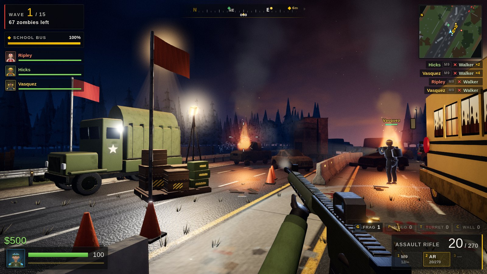

# Highway Horde

A first-person co-op zombie shooter for 1–6 players that runs in the browser. Pick a
survivor, hold the line on a jammed highway, a desert truck stop, a river bridge or an
army checkpoint — or run for the next safe zone across Harlan County — and gun down wave
after wave of the dead with your friends. Nothing to install: one person hosts, everyone
else opens the invite link.



## What's in it

- **Co-op for 1–6 players over the internet**, with a room code or an invite link, plus
  **AI survivors** to fill empty slots (great for playing solo or with one friend).
  Friends can join a game that's already running.
- **Story: Road to Haven**, a persistent co-op campaign (main menu → **Story**). Twelve
  missions in six chapters take a crew of survivors from the pileup on Highway 9 to the last
  ferry on Lake Harlan, through nine hand-built story levels played like a campaign level of a
  modern shooter: a town, a hospital, a mall, a dam, a rail yard, an airbase, the metro, a forest
  and the road between them, each a route of areas joined by gates, with set pieces, interiors
  and checkpoints (most of them by day; a "Daylight only" option plays them all by day). Twelve
  side jobs wait on the hideout board. Between missions you walk around a **hideout** (the Roadhouse, Blackwater
  Depot, the Harlan farmstead): the **mission board** picks the next job and the party ready
  check, the **workbench** upgrades your guns (tiers 1–5), the **armory** sets your three-gun
  loadout and the supplies you take along, the **infirmary** heals you, the **upgrade board**
  builds the hideout (generator, watchtower, infirmary, armory, radio mast, garden, palisade,
  three tiers each) and the **perk tree** spends the point you earn every level (12 perks, three
  ranks each, level cap 20). Briefings, arrivals, hideout conversations and the ending are
  played as dialogue scenes with portraits (click, Space or the gamepad's A to advance, Esc to
  skip, L for the log; an optional spoken voice per character is in Settings and off by
  default). Play solo with AI survivors, host online or join a friend, and the campaign
  goes on where you left it. See "Story saves" below.
- **46 guns**, in the buy menu's sections:
  - *Pistols*: M9 pistol (you start with it), compact 9mm (auto or 3-round bursts), tactical
    .45 (screw-on silencer), hand cannon, machine pistol, magnum, flare gun.
  - *SMGs*: micro SMG, compact SMG, .45 SMG, Tommy gun, twin SMGs, bullpup PDW (50-round top
    magazine).
  - *Heavy*: sawed-off, pump shotgun, combat shotgun, box-mag shotgun, auto shotgun, and the
    machine guns — the LMG, the M60 (100-round belt), the Barrage MG (150 rounds, its spray
    tightens as it keeps firing), the flamethrower, a belt-fed heavy MG carried at the hip with
    a 500-round belt, and the minigun.
  - *Rifles*: burst rifle, lever-action rifle, assault rifle, M4 carbine (screw-on silencer),
    AK-pattern rifle, battle rifle, scoped bullpup.
  - *Snipers*: scout rifle, sniper rifle, magnum sniper, semi-auto sniper, the .50
    anti-materiel rifle.
  - *Specials*: crossbow, chainsaw, harpoon gun, saw-blade launcher, cryo blaster, grenade
    launcher, rocket launcher, tesla gun, railgun — and the **Hollow Star**, the super weapon.
  Some have tricks: the burst rifle fires 3-round bursts, the lever-action loads one shell
  at a time, flares burn and light up the area where they land, the cryo blaster slows and
  then freezes zombies solid, the chainsaw cuts through everything in front of you, the
  harpoon skewers a line of zombies and pins them to the next wall, the .50 punches through
  thin cover, the saw-blade launcher's blades slice through a whole line of zombies and
  ricochet off walls to come back for more, and the Hollow Star charges up and fires a
  captive black hole that drags the horde in, grinds up what reaches its core and collapses
  in a shockwave. It's rare: wave 10 in the shop at $16,000, or a lucky drop from a boss.
  The right mouse button does what the gun has: zoom a scope, switch to bursts, screw a
  silencer on or off. There are also frag grenades, molotovs, sentry turrets and
  barricades.
- **8 kinds of zombie**, each with its own trick: walkers, runners, crawlers, bloaters
  that burst, spitters that lob acid, screamers that speed up the horde, charging brutes,
  and an Abomination boss every fifth wave.
- **6 survivor classes**:

  | Class | Role | Perk |
  |---|---|---|
  | Sarge | Soldier | More gun damage and faster reloads |
  | Doc | Medic | Revives twice as fast; teammates nearby heal |
  | Sparks | Engineer | Cheaper, stronger turrets, and starts with one |
  | Swift | Scout | Faster and earns more cash |
  | Boom | Demolitions | Bigger explosions and extra grenades |
  | Tank | Heavy | 150 health and a vest |

- **4 game modes**:
  - **Defend** (the classic): hold one spot against every wave, guarding the objective
    (or just surviving with it switched off).
  - **Evac Run**: every wave the safe zone moves to a new place on the map, a bit like a
    battle royale's circle. A countdown shows where to go (a teal ring on the compass, the
    minimap and a glowing wall you can see from across the map) and how long you have;
    a supply drop with ammo, first aid, armour and a weapon crate waits inside, and
    stragglers harass you on the way. When the wave starts the circle locks; later it
    shrinks to a smaller one inside it. Outside it the blight takes more and more health
    every second (armour doesn't help, downed survivors bleed out faster), and late in the
    wave zombies walk out of it. Clear the wave and the next zone is announced.
  - **Campaign** (Highway 9 Pileup, Checkpoint Delta and Harlan County, in daylight): four
    stages in one game. **Hilltop stand**: hold a fortified hill; the flank slows the horde
    and they take extra damage, and you deal a bonus from the high ground. **Breakout**: the
    hill is overrun; fight down the street to the tall tower while a red horde front walks
    behind you (anyone it catches takes escalating damage). **The ascent**: clear the lobby,
    the offices and the atrium floor by floor; the stairs open when a floor is clear.
    **Rooftop**: kill the quota (it grows with the team), then ride the zip line down to the
    landing pad. The game is won when every survivor still standing has escaped. It is an
    extension of those three maps: their default game is unchanged.
  - **Horde Elimination**: one round against a whole horde. A short buy time, then it comes in
    eight surges, each announced with the gates it comes through (the compass marks them),
    from shamblers to runners, specials, brutes and finally the bosses. Nobody respawns:
    downed survivors can still be revived, the dead watch. Kill every last one (the HUD counts
    them down) or be overrun. The horde grows with the team and the difficulty (150 zombies
    solo on Normal, 420 for four); the supply station stays open between surges. Played on
    Sandstone, and on every map except Harlan County.
- **3 story hideouts** (for the story campaign, not in the lobby): safe, walkable camps where the
  crew rests between missions, each with a mission board, workbench, armory, infirmary, upgrade
  table, bed, campfire and a shooting range whose targets show your damage numbers. **The
  Roadhouse** is a desert motel and diner at dusk (buzzing neon, string lights, a fire ring with log
  seats, a pickup that finally runs), **Blackwater Depot** a rail yard beside a water tower (boxcar
  bunks, a glowing forge shed, a greenhouse made of doors and windows), and **Harlan Farmstead** a
  barn, porch, orchard and pond at golden hour (chickens, a windmill, hanging lanterns). Seven
  upgrades (Generator, Watchtower, Infirmary, Armory, Radio Mast, Garden, Palisade, three tiers each)
  visibly grow the camp; the hideouts have their own ambience (crickets, fire crackle, a distant
  radio) and a warm, slow score. See SPEC §3.10; try them in `public/dev/fps-sandbox.html?map=roadhouse&up=3`.
- **Night or day.** The lobby's **Time** row (next to Mode) sets Night (the original moonlit,
  flashlight-and-fire-light look, the default) or Day: a bright sunny variant of every map with a
  gradient sky, sun and drifting clouds, long soft shadows, haze in the distance, the lamps off and
  the flashlights not needed. Each map has its own day: hazy tarmac heat on the highway, bleached
  desert at the truck stop, a glittering river at the bridge, a cloudier checkpoint, and green farm
  country with a deep blue sky at Harlan County. The choice is saved with your other lobby settings
  and changes nothing about the fight; a map made for the daytime only (like a hilltop or rooftop
  map) plays Day whatever you pick, the way Harlan County only plays the Evac Run. Sandstone also
  plays at **Dusk**: a low gold sun, very long shadows and the lanterns coming on.
- **6 maps**: four built around something to defend — a school bus in a pileup that
  stretches for miles down Highway 9 (two crossroads with dead traffic lights, a gas
  station and a motel, and the I-44 overpass crossing overhead on its piers, with the horde
  coming down the ramps), a diner full of survivors, an APC broken down in the middle of a
  bridge, and a radio tower at a crossroads checkpoint (each also plays the Evac Run over
  its own spots) — and **Harlan County**, a big square of farm country made for the Evac
  Run: Main Street in the town of Harlan, the Gas-N-Go, Haskell Farm with its barns and
  silos, St. Jude's church and graveyard, a field hospital behind HESCO walls, the I-70
  interchange with its ramps, Miller Quarry & Lumber, the radio mast on Radio Hill, the
  Shady Pines trailer park and the marina on Lake Harlan, joined by county roads through
  fields and woods — and **Sandstone**, a sun-baked walled desert town made for Horde
  Elimination: Fountain Square and the raised Terrace to hold, the long walled Long Hall
  under the rampart, Mid Street through the great wooden doors, the Cistern Court, dark
  tunnels into Well Square, a souk under striped awnings and six gates for the horde.
  Played by day (the default), at dusk with lanterns coming on, or by night.
- **First person, in 3D.** You see the road over your own gun: your flashlight
  cutting through the dark, the horde coming out of the fog, teammates fighting beside
  you with their name tags overhead. A compass strip points to the objective and the supply station, a
  rotating radar shows the horde around you, and red arcs show where a hit came from.
  Sounds come from where they happen: a groan behind you is quieter and muffled.
- Night-time lighting with flashlights, muzzle flashes, burning wrecks and explosions (or a
  full daylight variant with sun shadows, haze and clouds).
  Blood and scorch marks stay on the ground, and all the sound (every gun, every zombie,
  the music) is synthesised in the browser. All the art is built in code: no model or
  texture files.
- **Classic top-down view** as an option in Settings, for anyone who prefers the old
  bird's-eye game (and used automatically on browsers without WebGL 2).
- **Rules:** downed players bleed out unless a teammate revives them. Cash from kills
  buys guns and gear between waves, or mid-wave at the supply station. The game supports
  keyboard and mouse, gamepads, and touch screens.

## Playing from a file on your computer

Browsers won't run `public/index.html` opened straight from a folder (they block the game's
module scripts on `file://` pages). Build the one-file version instead:

```bash
cd highway-horde
npm install
npm run standalone   # → dist/Highway-Horde.html
```

Double-click `Highway-Horde.html` to play. Online games work from it too: the host clicks
**Host Online Game** and reads out the room code, and friends (each with their own copy of
the file, or the website) use **Join Game** with that code. Invite links point at the
host's own disk, so use the code.

The file carries every texture (their download copies, about 430 MB; the menu is up while
the browser is still reading the rest). `HH_NO_TEXTURES=1 npm run standalone` builds a ~5 MB file
that draws the surfaces with the procedural layers instead.

## The texture library

`public/textures/` holds the game's own materials: 55 tileable PBR sets (brick, concrete,
asphalt, plaster, wood, metal, tile, ground…) and the hero sets of the story levels, each as
albedo, normal, roughness / AO / height and metalness / tint PNGs. They are made by our own
code, not downloaded: `node scripts/bake-textures.js` renders them at 2048² and stores them at
1024² (`--only brick_red --preview <dir>` re-bakes one material and writes lit previews). The
game uses them on High and up; Low keeps the procedural layers, and so does any page where
they fail to load (or the address has `?textures=procedural`).

The PNGs under `public/textures/` (world sets, guns, zombies, decals) are the lossless source;
the game downloads smaller copies of them: `npm run textures:compress` (needs ImageMagick)
writes a JPEG 4:4:4 copy of every opaque colour, normal and packed map, a lossless WebP of every
mask and of anything with an alpha channel, and halved copies of the maps above 1024² for the
tiers that never use them at full size, and lists them in `public/textures/compressed.json`
(with each PNG's SHA-1). **Run it after re-baking or replacing any PNG** — `npm test` fails while
a copy is stale, and the one-file build ships a stale copy's PNG instead. The files are decoded
off the main thread (render3d/tex-worker.js); `npm run timing` measures the load times
(scripts/load-timing.js).

## Playing with friends

The host's browser runs the game and everyone else connects to it. There are three ways to
put it online; the first is the easiest.

### 1. Static website (no server to run)

Upload the `public/` folder to any static host. With **Netlify** you can drag and drop
the folder onto <https://app.netlify.com/drop>, or connect this repository and set the
base directory to `highway-horde` (the included `netlify.toml` does the rest). GitHub
Pages, Cloudflare Pages and similar hosts work the same way.

Open the site, click **Host Online Game**, then **Copy invite link**, and send the link
to your friends. The game connects players directly to each other (WebRTC, through the
free PeerJS signalling service), so nothing else needs to run.

Direct connections work on most home networks. If a friend can't connect (some
corporate, school or mobile networks block peer-to-peer traffic), use option 2, or add a
TURN server in `public/config.js`.

### 2. Your own server (most reliable)

```bash
cd highway-horde
npm install
npm start            # http://localhost:8080  (set PORT to change it)
```

This serves the game and a small WebSocket relay that forwards traffic between players.
Everyone only talks to your server, so it works on any network. Deploy it to any Node
host that supports WebSockets (Render, Railway, Fly.io, a VPS). To play from your own PC
without deploying, expose it with a tunnel, for example
`cloudflared tunnel --url http://localhost:8080`, and share that URL.

### 3. Same Wi-Fi / LAN

Run `npm start` and have everyone open `http://<your computer's IP>:8080`.

## Story saves

There is no account and no server for the story: everything is kept in **your browser**
(`localStorage`), in two pieces.

- **Your survivor** (name, class, level, XP, perks, scrap, guns and their upgrades, loadout)
  belongs to you. It goes with you into any friend's campaign: when you join, your browser
  sends it to the host, who checks it (level, XP, scrap and guns have to add up) and keeps the
  accepted version for the session. What you earn comes back to your browser.
- **The campaign** (the crew's name, difficulty, missions cleared with their stars, the hideout
  and its upgrades, the stash, the story flags, the day) is a shared world. Every player who
  takes part keeps a **copy**, and the host sends everyone the new one after each change. A
  revision number decides which copy is newest, so the campaign survives its first host.

**Story → New campaign** starts one (solo with AI survivors, or hosted online); **Continue** on
a campaign card resumes it; **Export** (per campaign, or **Export everything**) downloads a
`.json` save; **Import save…** merges a file back in (the newer copy of each campaign wins, and
you are asked before your survivor is replaced by a different one); **Delete** removes it from
this browser only.

### How friends continue a campaign

Anyone who played a campaign has a copy, so any of them can host it later, and the others simply
join as usual.

1. The host opens **Story**, picks the campaign card and clicks **Host online** (or picks the
   copy they imported from a friend's export file).
2. They send the invite link or room code. Friends click **Story → Join a friend** (or open the
   link) and land in the story lobby with their own survivor.
3. If a friend has played the campaign since the host last did, their browser hands over the
   newer copy automatically; no file is needed. If the original host is gone for good, one
   of the crew exports the campaign and everybody imports the file (or that person hosts).
4. **Enter the hideout** and the crew walks on from the saved point, hideout upgrades and all.

If the host leaves in the middle of a session, everyone keeps their copy of the campaign and their
survivor, and any of them can host it again. A mission left unfinished simply isn't banked.

## Controls

**Click the game to capture the mouse**, then move the mouse to look around; your aim is
wherever the crosshair is. **Esc** gives the mouse back and opens the menu (online the game
keeps running and your survivor just stands still; in **Play Solo** the menu really pauses the
game, and says so); the menu's **Click to Resume** button captures the mouse again. On a PC, hit **Fullscreen** on the title screen, in the pause menu or
in Settings (or tick *Start games in fullscreen*). In Chrome and Edge, Esc then only
releases the mouse and opens the menu; hold Esc to leave fullscreen.

| Action | Keyboard & mouse | Gamepad |
|---|---|---|
| Move (forward / strafe) | WASD or arrows | Left stick |
| Look & aim | Mouse (click the game first) | Right stick |
| Shoot | Left click | RT |
| Secondary fire: scope / burst / suppressor (guns that have one) | Right click | Tap LT |
| Crouch (hold: steadier, slower) | C (or Ctrl) | Click right stick (toggle) |
| Walk (hold: quiet, steady) | X | Push the stick part way |
| Inspect your gun | Y | — |
| Release the mouse / menu | Esc | Start |
| Jump / climb (Space into a car, van or container) | Space | A |
| Shove | V, or right click on a gun without a secondary mode | LT (hold it on a gun with one) |
| Sprint | Shift | Click left stick |
| Reload | R | X |
| Revive (hold) / take crate | E | RB |
| Switch weapon | 1 2 3, wheel, Q for last | Y, D-pad ▶ |
| Throwables: frag / molotov | G (tap throws the selected one, hold switches) | LB (tap / hold) |
| Buildables: turret / barricade | T (tap places the selected one, hold switches) | D-pad ▲ (tap / hold) |
| Shop | B | Tap Back |
| Ready up (skip the break) | N | D-pad ◀ |
| Scoreboard / chat | Tab / Enter | Back / — |

Crouch, walk and inspect sit on browser-safe keys and can be moved in Settings → Controls →
Keys (click the key, press the new one; a profile saved with the old crouch key Z moves to C,
custom keys stay). The utility keys are fixed: **G** throws a frag or a molotov and **T** places a
turret or a barricade. A quick tap uses the selected item; hold the key a moment to switch to the
other one (the gear row shows the choice and lights up both while you switch). Ctrl works for crouch too, as in other shooters:
while you play, Ctrl+letter shortcuts stay in the game, in fullscreen even Ctrl+W does, and
outside fullscreen the browser asks before closing the tab if you press Ctrl+W by accident.

On phones and tablets the left thumb moves, dragging on the right half of the screen
looks around, and a big FIRE button shoots (drag it to keep turning while you fire); JUMP
sits next to it and the other actions have on-screen buttons. The buttons that only matter
sometimes (USE, SHOP, READY) appear only while they do something, and FRAG, MOLO, TURRET and WALL
fold into one GADGET button that opens a small tray. With a sniper (or any gun
with a secondary mode) the SHOVE button shows ZOOM / BURST / SIL: tap it for that, hold it
to shove. Gamepads and touch get a light aim assist.

**Shooting works like a tactical shooter.** Every gun has its own fixed spray: the first
rounds climb, then it wanders side to side, the same every time — learn it and pull down
against it, or shoot in short bursts and taps; the view kicks up about half as far as the
bullets go and settles when you let go. The first shot of a gun that is standing still and
rested goes where the crosshair is; moving, jumping, landing and spraying open the cone, and
the dynamic crosshair shows how far. Running guns are fastest to stop by tapping the
opposite key. Crouching and walking steady your aim, and sprinting means you can't hit
anything. Heads take four times the damage (twice on brutes and the Abomination), the
stomach a bit more, legs less, and a leg hit slows a zombie for a moment. Rifles and snipers
punch through fences, doors, thin walls and car bodies at reduced damage; pistols and SMGs
barely. Snipers are wild unscoped: right click for the scope (twice to zoom further). The
kill feed marks headshots and kills through cover. A heavy gun takes a moment to bring up
after a switch.
Every device starts on the **Ultra** graphics preset with **Auto** resolution: on a desktop
screen with room to spare it renders *above* your screen's resolution (up to 150%, then
shrinks the picture back for very smooth edges) and lowers it only when a big fight would
drop below your display's refresh rate (Auto aims at 97% of it, so 58 fps on a 60 Hz screen
and 140 on a 144 Hz one; the game measures the rate itself and has no 60 fps limit). For the
sharpest picture pick **150%** or **200%** in Settings, if your graphics card can take it.
On phones and tablets Ultra makes the device run warm and drains the battery faster; pick
High or Low if it stutters.

**For RTX-class graphics cards pick Cinematic** (Settings → Graphics) **with Auto or
150–200% resolution.** Cinematic is the top preset for a strong desktop GPU at 1080p,
1440p or 4K: 4× multisampling (MSAA) on top of SMAA, cascaded 4096² sun and moon shadows
with a razor-sharp near cascade and a 4096² flashlight shadow, full-resolution ambient
occlusion, contact shadows, volumetric light shafts through the sun's shadow map, denser
and higher-quality reflections, a wide, smooth bloom with subtle lens dirt and colour
fringing, camera motion blur (off by default), depth of field while you are hurt, 20 lights
instead of 12, two to three times the particles, decals and gibs, a denser world (grass, fireflies, rain, set
dressing up to 2.5 million triangles), 16× anisotropic filtering and a supersampled picture
shrunk back with a Catmull-Rom filter. Every one of those has its own switch under
*Advanced* → *Cinematic extras*. The first time you start the game it looks at your
graphics card (NVIDIA RTX 20/30/40/50 and GTX 1080, AMD RX 6700 and up, Intel Arc A750 and
up, Apple M2 and up, ...) and picks Cinematic for you; Settings says *Detected: … —
Cinematic recommended*. A quality you picked yourself is never changed. Want to know
what your card manages? Open `/dev/benchmark.html` on the same address as the game: it flies a
20-second camera path over the highway map at your current settings (or the quality, resolution
and MSAA you pick there) and prints the average frame rate, the 1% and 0.1% lows, the
frame-time percentiles and the GPU time, ready to copy.

**Settings** (title screen or pause menu → Settings) has four tabs:

- **Graphics**: a preset (Cinematic, Ultra, High, Low; the detected graphics card is named
  under it), the resolution (Auto, 200%, 150%, 125%, 100%, 85%, 70% or 50%; above 100% draws extra pixels for a sharper picture
  and carries a *Heavy GPU* badge, as do 8× MSAA, 4K shadows and volumetric fog; MSAA is held to 2× while the
  resolution is above 100%, and the tab says so; a *Recommended* hint follows your card, preset and screen size)
  and, under *Advanced*, anti-aliasing (SMAA, FXAA, off), bloom, ambient occlusion, film
  grain, vignette and night lighting, and on Cinematic the extras (MSAA off / 2× / 4× / 8×, 4K
  cascaded shadows, contact shadows, full-resolution occlusion, high-quality reflections
  and light shafts, motion blur, depth of field, lens effects). Tweaking an effect marks the preset *Custom*. *Gore*
  (On, Low, Off) is separate from the presets: Low thins out the blood and drops severed
  limbs, Off paints dark ash instead of red and nobody is blown apart.
- **Display & HUD**: fullscreen, *Start games in fullscreen*, the UI size (Auto scales
  the menus and HUD with your screen, from 720p up to 4K; 75% to 150% on top of that), the
  HUD safe area (on ultrawide monitors *16:9* keeps the HUD near the middle of the
  screen), the frame-rate limit (Off follows the display; 60, 120 or 144; v-sync is the
  browser's and your graphics driver's), display calibration (brightness, contrast and colour
  sliders), the FPS / resolution / ping readout (with the tier, the internal resolution,
  MSAA and, where the browser has a GPU timer, the milliseconds of each render pass), name
  tags, the rotating minimap and screen shake.
- **Controls**: the view (**First-person** or **Classic top-down**; a change applies
  from the next game), field of view (60–120 horizontal degrees on a 4:3 screen, 80 by
  default; wider screens see more at the sides), mouse sensitivity, stick and touch look
  speed, invert Y, aim assist and raw mouse input (skips the OS pointer acceleration where
  the browser supports it); the keys for crouch, walk and inspect; and the crosshair, with a
  live preview: dynamic (opens with your movement and spray) or static, colour, length,
  thickness, gap, opacity, centre dot and outline (and a developer view of the zombies' hit
  volumes).
- **Audio**: master, effects and music volume, and mute. The soundtrack is an adaptive
  orchestral score (choir, strings, horns, harp, war drums) synthesised in the browser:
  calm while you shop and get ready, building as the wave comes, full battle music as
  the horde grows, heavier for bosses, a short fanfare when a wave is cleared.

In the classic top-down view the mouse points where you shoot and nothing is captured.

## Tips

- Stay near the objective. Zombies go for whoever is closest, and chew on the
  objective when nobody is around. The ◆ on the compass always points to it.
- Check behind you. The horde comes from every side; listen for groans at your back and
  turn toward the red arcs when something hits you.
- Campaign: stay on the high ground on the hill; on the breakout keep ahead of the red
  front and don't stop to fight; on the roof spread the kills, revive fast and ride together
  (E at the gantry once the quota is met).
- Revive downed teammates by holding E next to them. They have 30 seconds.
- Jump (Space) over guard rails, jersey barriers, sandbags and fences to cut corners or get
  away; sprint first for a longer leap. Crawlers can't reach you while you're in the air.
- Climb: press Space while walking into a car, van, pickup, HESCO wall or container and you
  pull yourself up onto it ("SPACE — climb" shows when you face one). From up there you
  shoot over the cover around you, and you can hop from roof to roof; walk off the edge to
  get down. It buys you time, not safety: zombies grab your legs on a car roof, runners
  and walkers climb up after you, brutes knock you off and spitters still lob acid.
  Buildings, tall walls and trucks are too high (trucks only from a roof next to them).
- The shop is open between waves. Mid-wave, you can only buy at the supply station (in
  an Evac Run also at the zone's supply drop).
- Buy fast: press B, then a digit for the section (1 pistols, 2 SMGs, 3 heavy, 4 rifles,
  5 snipers, 6 specials, 7 equipment) and a digit for the item — B 4 2 buys the second
  rifle. Backspace goes back; Q and E step through the sections. With a gamepad: the
  D-pad and A, LB / RB for the sections, B to go back.
- Evac Run: leave for the next zone as soon as it's announced, and press N once you're
  in to start the wave early. When the circle shrinks, head for the white ring.
- Every fifth wave brings a boss. Save a frag or two for it.

## Development

Plain ES modules with no build step, running in the browser as-is. The architecture and
module contracts are described in [SPEC.md](SPEC.md), and the balance data and
reasoning in [docs/BALANCE.md](docs/BALANCE.md).

```bash
npm test                    # unit tests (node:test)
npm run e2e                 # browser tests: solo, 3-player relay, late join, p2p, phone, bots,
                            #   first-person solo, first-person 2-player relay, an Evac Run, the Campaign, a
                            #   Road to Haven story mission, a Story campaign (new game, a mission, the
                            #   debrief, export/import), a story level and a Horde Elimination round
FULL_MISSIONS=1 npm test    # also plays the story missions to the end with four bots
node scripts/balance.js     # headless bot playtests across maps, difficulties and team sizes
node scripts/balance.js --mode zone --maps harlan   # ... of the Evac Run
node scripts/balance.js --mode campaign             # ... of the whole Campaign
node scripts/balance.js --mode horde --maps sandstone  # ... of Horde Elimination
```

The simulation is 2D and deterministic (a flat ground plane, like classic Doom-style
shooters: aim is the view's yaw, bullets fly level), so the first-person view is purely a
renderer: `public/js/render3d/` turns the same snapshots the classic view draws into a
three.js scene. The `public/dev/` folder has sandboxes for both renderers, audio,
networking and UI.

PeerJS and three.js (both MIT licence) are vendored in `public/vendor/`.
